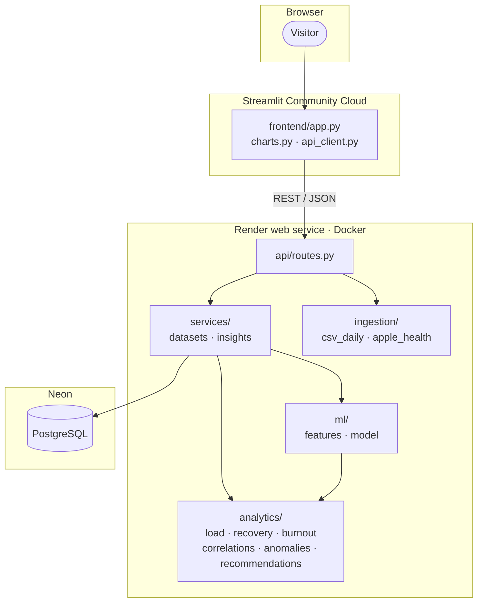
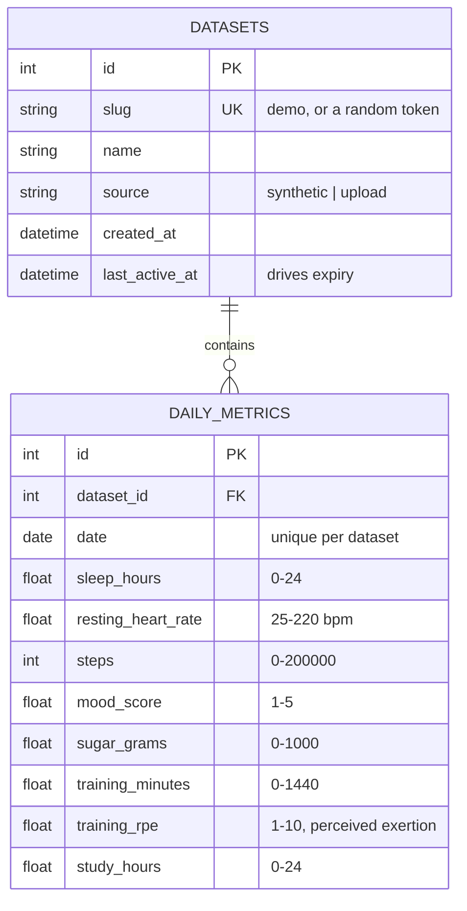

# Health & Performance Aggregator: Design Documentation

> **Not medical advice.** This is a software portfolio project. Its scores, alerts and predictions describe patterns in the data it is given. They are not validated clinically and must not be used to diagnose, treat or prevent any condition. If you are worried about your health, talk to a qualified professional.

## 1. Problem

People who track their health and performance end up with fragmented data: a wearable for sleep and heart rate, an app for workouts, notes for mood and study time. Each tool shows its own numbers, so the interactions that matter most (does a heavy study week cost me sleep? is my training ramping up faster than I recover?) stay invisible.

This project puts those signals in one place and turns them into insights that can each be traced back to the data that produced them.

## 2. System design



Design decisions:

- **The dashboard has no logic.** It calls the API and draws what comes back. Every number can therefore be tested without a browser, and another client could reuse the API.
- **Analytics are pure functions of a DataFrame.** `analytics/` and `ml/` know nothing about HTTP or the database, which keeps them easy to test with hand-made frames.
- **Datasets instead of accounts.** There is no login. The bundled demo data lives in a read-only dataset called `demo`. Each visitor who uploads a file gets their own dataset, addressed by a random 128-bit slug. The dashboard puts that slug in the page address (`?data=...`), which makes the address a private link: reloading or bookmarking it returns to the same data, and sharing it shares the data. The API never lists datasets, a visitor's dataset is deleted after `UPLOAD_TTL_DAYS` (90 by default) without being opened or changed, and the number of datasets is capped.
- **Models are trained on request.** The model is a logistic regression on at most a few hundred rows and trains in about 0.1 s, so there are no model files to version or deploy and the result always matches the data.
- **One error shape.** Every 4xx response is `{"detail": {"message": "...", "errors": ["..."]}}`, so clients can show a headline and the specifics.

### Daily check-in

The dashboard's check-in form posts one day to `POST /records`. Values are merged into the day if it already exists, so a morning entry (sleep) and an evening entry (mood, training, study) add up to one row, and a check-in can fill in the signals a wearable export lacks. The first check-in creates the visitor's dataset and turns the page address into their private link.

### Request flow for an upload

1. The dashboard creates a dataset (`POST /api/v1/datasets`) and keeps the slug in the page address.
2. It posts the file to `/import/csv` or `/import/apple-health`. The file is size-limited and parsed.
3. Every day is validated with Pydantic. A CSV with any invalid row is rejected as a whole with line-numbered messages.
4. Valid days are merged into the dataset: new dates are inserted, existing dates keep the values the new file does not carry.
5. The dashboard re-fetches metrics, insights and the prediction for that slug.

## 3. Data model



Every metric is nullable, because sources differ: Apple Health has no mood or study time, and a hand-kept CSV may have no heart rate. Each analysis uses whatever is present and says so when it cannot run.

The schema is managed with Alembic (`backend/alembic/`). `DATABASE_URL` selects the database: SQLite by default, PostgreSQL in production. A test checks that the migrations produce the same tables as the models, and CI runs the suite against both databases.

## 4. API

Interactive documentation is served at `/docs`. All dataset routes are under `/api/v1/datasets/{slug}`.

| Method | Path | Purpose |
| --- | --- | --- |
| GET | `/health` | Liveness and database check |
| POST | `/api/v1/datasets` | Create an empty dataset for uploads |
| GET | `/api/v1/datasets/{slug}` | Name, source, number of days, date range |
| DELETE | `/api/v1/datasets/{slug}` | Delete an uploaded dataset |
| POST | `/api/v1/datasets/{slug}/import/csv` | Import a daily-metrics CSV |
| POST | `/api/v1/datasets/{slug}/import/apple-health` | Import an Apple Health `export.zip` or `export.xml` |
| POST | `/api/v1/datasets/{slug}/records` | Add or update days as JSON |
| GET | `/api/v1/datasets/{slug}/metrics` | Raw daily records, optional `start` / `end` |
| GET | `/api/v1/datasets/{slug}/metrics/derived` | Per-day load, ACWR, readiness, burnout risk |
| GET | `/api/v1/datasets/{slug}/insights` | Correlations, anomalies, load, recovery, burnout, recommendations |
| GET | `/api/v1/datasets/{slug}/prediction` | Next-day prediction, evaluation and explanation |

### Supported import formats

**Daily-metrics CSV.** One row per day, a `date` column (ISO format) and any of the metric columns from the data model. Example: `data/samples/demo_daily_metrics.csv`.

**Apple Health export.** Either the `export.zip` that the Health app produces, uploaded as it is, or the `export.xml` inside it. From a zip, the records file is found by name (it is translated in some languages; the clinical summary `export_cda.xml` and GPX routes are ignored) and decompressed as a stream, so it never has to fit in memory. The parser reads it with `defusedxml` and aggregates per day:

| Daily value | Apple Health source | Rule |
| --- | --- | --- |
| `steps` | `HKQuantityTypeIdentifierStepCount` | Sum per device, then take the largest device, because a phone and a watch both count the same steps |
| `sleep_hours` | `HKCategoryTypeIdentifierSleepAnalysis` | Time in "asleep" stages only (not "in bed" or "awake"), assigned to the wake-up day, largest device |
| `resting_heart_rate` | `HKQuantityTypeIdentifierRestingHeartRate` | Mean of the day's readings |
| `sugar_grams` | `HKQuantityTypeIdentifierDietarySugar` | Sum |
| `training_minutes` | `Workout` elements | Sum of durations |

`data/samples/apple_health_export_sample.xml` is a synthetic file written in this format by `backend/scripts/generate_apple_health_sample.py`. Limitations: uploads are capped at `MAX_UPLOAD_MB` (20 MB by default) and the XML inside a zip at `MAX_UNZIPPED_MB` (200 MB by default), enforced on the bytes actually decompressed. Export XML compresses very well, so the zip limit covers far more history than the same limit did for raw XML, but a multi-year export with many workout routes can still exceed it. Parsing runs at roughly 45 MB of XML per second on a laptop and much slower on the free hosting tier; the parser has been tested against the format as documented and against the synthetic sample, not against a wide range of real devices.

## 5. Analytics

All rolling windows run over calendar days; days missing from the data are treated as gaps, not skipped.

### Training and cognitive load (`analytics/load.py`)

- **Daily training load** = training minutes x RPE (the session-RPE method). A day with no workout counts as 0. If a workout has no RPE, as with Apple Health, a moderate 5 is assumed.
- **Acute load** = mean of the last 7 days. **Chronic load** = mean of the last 28 days (reported once 21 days exist).
- **ACWR** = acute / chronic. Zones: under 0.8 undertraining, 0.8-1.3 optimal, 1.3-1.5 caution, over 1.5 high.
- **Study load** uses the same windows on study hours.

The zone thresholds come from the sports-science literature on workload ratios (Gabbett, 2016). That literature is contested, and the thresholds are used here as a readable heuristic, not as injury prediction.

### Readiness and recovery (`analytics/recovery.py`)

Readiness is a 0-100 weighted average of three components, re-weighted over whichever are available:

| Component | Weight | Scaling |
| --- | --- | --- |
| Sleep | 0.4 | 4 h or less = 0, 8 h or more = 1 |
| Resting heart rate | 0.3 | At the personal 28-day baseline = 0.5; 5 bpm above = 0; 5 bpm below = 1 |
| Mood | 0.3 | 1 = 0, 5 = 1 |

The **recovery trend** compares mean readiness over the last 7 days with the 7 days before: more than 3 points up is "improving", more than 3 down is "declining".

### Burnout risk (`analytics/burnout.py`)

A 0-100 weighted average of five strain components, each scaled to 0-1 and averaged over 7 days:

| Component | Weight | 0 means | 1 means |
| --- | --- | --- | --- |
| Sleep debt | 0.25 | 8 h every night | 2 h short every night |
| Training strain | 0.25 | ACWR at or under 1.0 | ACWR 1.8 or more |
| Low mood | 0.20 | Weekly mood 3.5 or more | Weekly mood 1 |
| Cognitive strain | 0.15 | 4 study hours a day or fewer | 9 a day |
| Elevated heart rate | 0.15 | At or below baseline | 6 bpm above baseline |

At least two components must be available. Levels: under 33 low, 33-66 moderate, above 66 high. The weights and cut-offs are judgement calls chosen to be easy to explain; they have not been validated against any burnout instrument.

### Weekly summary (`analytics/weekly.py`)

For readiness, sleep, resting heart rate, mood, training load, study hours and steps: the daily average over the last 7 days against the 7 days before. A signal is included only if both weeks have at least 3 logged days. Each entry says whether higher is better, so the dashboard can colour the change; training load and study hours are marked as neither, because more is not simply good or bad.

### Correlations (`analytics/correlations.py`)

Pearson correlation for a fixed list of pairs, optionally lagged (for example training load against the next day's resting heart rate). A pair needs at least 14 overlapping days. Each result carries `r`, the p-value, the sample size and a strength label (under 0.2 negligible, 0.4 weak, 0.6 moderate, otherwise strong). The wording is always "tends to go with": correlation does not show causation, and several pairs tested at once will sometimes look related by chance.

### Anomalies (`analytics/anomalies.py`)

- **Poor sleep:** under 5 hours.
- **High resting heart rate:** more than 1.5 standard deviations and at least 3 bpm above the mean of the previous 7 days. The day being tested is excluded from its own baseline.
- **Training-load spike:** the first day of each stretch with ACWR above 1.5.

### Recommendations (`analytics/recommendations.py`)

Plain rules over the latest values. Each recommendation is returned with the observation that triggered it, for example "7-day average sleep is 5.8 h".

## 6. Machine learning

### Task

Predict, at the end of day *t*, whether day *t + 1* will be a **low-readiness day**: readiness below the 33rd percentile of the person's own readiness in the training period. The label is personal, so "low" means low for you.

### Features

Ten features, all computed from day *t* or earlier (a test tampers with later days and checks the features do not change):

today's readiness, 3-day average sleep, 7-day average sleep shortfall against 8 h, resting heart-rate deviation from baseline, 3-day average mood, today's training load, 7-day training load, ACWR, today's study hours, 7-day study hours.

Features that a dataset never records are dropped; occasional gaps are filled with the training median.

### Model

Standardised, L2-regularised logistic regression (scikit-learn), with balanced class weights. The regularisation strength is chosen by expanding-window cross-validation inside the training period.

Why this model: there are at most a few hundred rows, so a linear model is about as much as the data can support, and its coefficients are directly interpretable. The dashboard shows them twice: globally (log-odds per standard deviation of each feature) and for the latest prediction (coefficient x standardised value, the push each feature gives).

### Evaluation

- **Split by time.** The first 21 days are skipped as warm-up for the rolling features. Of the remaining labelled days, the first 75% are for training and the most recent 25% for testing. Nothing is shuffled, and the low-readiness cut-off is computed from the training period only.
- **Metric.** ROC-AUC, with accuracy, precision and recall at a 0.5 threshold.
- **Baselines.** Always predicting the majority class, and persistence: ranking days by today's readiness alone ("tomorrow will be like today").
- After evaluation the model is refitted on all labelled days to make the prediction for tomorrow.

Results on the bundled synthetic dataset (118 training days, 40 test days):

| | ROC-AUC | Accuracy |
| --- | --- | --- |
| Logistic regression | 0.79 | 72% |
| Persistence baseline | 0.82 | n/a |
| Majority-class baseline | n/a | 60% |

Expanding-window cross-validation over the whole dataset (`backend/scripts/compare_models.py`, mean of four folds):

| Model | Mean ROC-AUC |
| --- | --- |
| Logistic regression | 0.80 |
| Persistence baseline | 0.78 |
| Gradient boosting (depth 2, 100 trees) | 0.71 |

### What these results mean

- The model is clearly better than chance and than the majority baseline, but it is **not reliably better than persistence**. It loses on the hold-out and wins narrowly in cross-validation; with 40 test days neither difference is meaningful. Readiness is strongly autocorrelated, so "like today" is a hard baseline to beat.
- Gradient boosting does worse: there is too little data for it.
- The value of the model in this project is the explanation (which signals are associated with a bad day tomorrow), not extra accuracy.

### Validation on real data

The synthetic results above only show that the pipeline works. To see how the method does on real people, `backend/scripts/validate_on_pmdata.py` runs the same procedure on [PMData](https://datasets.simula.no/pmdata) (Thambawita et al., [MMSys 2020](https://doi.org/10.1145/3339825.3394926), CC BY 4.0): 16 people logged for about five months with a Fitbit Versa 2 and daily self-reports. Each participant is converted to this project's daily format (sleep, resting heart rate, steps, mood, training minutes and exertion; no study hours or sugar) and gets their own model, split by time exactly as in the app. The full per-participant tables are in [docs/pmdata-validation.md](docs/pmdata-validation.md).

Two targets were tested:

| Target | Participants evaluated | Model ROC-AUC (mean / median) | Better than chance | vs persistence |
| --- | --- | --- | --- | --- |
| **Computed readiness**: the app's own score from sleep, heart rate and mood | 15 of 16 | 0.64 / 0.67 | 13 of 15 | Ahead for 9 of 12 (mean 0.65 vs 0.58) |
| **Self-reported readiness** (0-10), measured independently of the features | 11 of 16 | 0.53 / 0.47 | 5 of 11 | Ahead for 2 of 6 (mean 0.47 vs 0.51) |

What this shows:

- **For the score the app computes, there is a modest real signal.** The model is above chance for most people and ahead of "tomorrow will be like today" more often than not. On real data persistence is a much weaker baseline (0.58) than on the synthetic data (0.82), because real day-to-day readiness is less autocorrelated than the generator assumes.
- **For how ready people say they feel, the model is no better than chance.** Averaged over participants it scores 0.53, and results swing from 0.24 to 0.95 between people. Predicting a subjective rating from a watch and a training log, one person at a time, did not work here.
- **Individual numbers are unreliable.** Each test set is only 16 to 33 days, so a single participant's ROC-AUC can move a lot by chance. Only the pattern across participants means anything, and with 16 people even that is weak evidence. No significance tests were run.
- Participants that could not be evaluated were skipped by the same guards the API applies (too few days, or too few low-readiness days in the test period), not removed by hand. Nothing was tuned on PMData: the features, model and thresholds are the ones chosen on the synthetic data.

To reproduce, download the participant folders from <https://osf.io/vx4bk> (they are not redistributed in this repository) and run:

```bash
python backend/scripts/validate_on_pmdata.py path/to/pmdata --output docs/pmdata-validation.md
```

### Limitations

- **Synthetic data.** The demo dataset is generated by `backend/scripts/generate_synthetic_data.py`, where a hidden fatigue state drives the signals. Good scores on it show that the pipeline works, not that the model would work for a real person; the PMData validation above is the evidence for that, and it is mixed.
- **Small samples.** A test set of 40 days gives wide uncertainty. No confidence intervals are reported.
- **The label is derived from the inputs.** Readiness is itself computed from sleep, heart rate and mood, so the model predicts tomorrow's value of a formula, not an independently measured outcome such as illness or performance.
- **Per-dataset training.** An uploaded dataset gets its own model only if it has about 81 days and enough low-readiness days in its most recent quarter. Otherwise the API returns `available: false` with the reason.
- **Associations only.** Coefficients describe association in one person's data, not causes, and correlated features share credit arbitrarily.
- **Not validated clinically.** See the note at the top of this document.

## 7. Privacy and security

- No accounts and no personal identifiers are stored; a dataset is a set of daily numbers under a random key.
- Visitor datasets expire automatically after 90 days without use and can be deleted from the dashboard at any time.
- The private link is a capability: anyone who has it can read and add to that dataset until it expires. It appears in the browser's address bar and history, so it should be treated like a password. Real accounts are on the roadmap.
- XML is parsed with `defusedxml`, which refuses entity-expansion attacks; uploads are size-limited, and zip archives are limited by decompressed size as well, so a small file cannot expand into a huge one.
- Secrets (the production database URL) are set in the hosting dashboards. `.env` files are git-ignored and `.env.example` documents the variables.
- Known gap: there is no rate limiting beyond the cap on the number of uploaded datasets.

## 8. Deployment

See [docs/DEPLOYMENT.md](docs/DEPLOYMENT.md). In short: the API runs as a Docker web service on Render's free tier, the database is Neon's free PostgreSQL, and the dashboard runs on Streamlit Community Cloud with `BACKEND_URL` set as a secret. The demo dataset is re-seeded from the repository on every API start, so a new visitor always sees data.

## 9. Testing

`pytest` covers:

- **Analytics:** hand-built frames with known answers for load, ACWR, readiness, burnout, correlations and each anomaly rule.
- **Parsers:** valid files, each kind of invalid file, double counting, sleep stages, malicious XML, zip archives including oversized and forged ones.
- **API:** every endpoint, error shapes, the read-only demo, expiry and capacity limits, on SQLite and PostgreSQL.
- **PMData reader:** mapping onto the daily schema, gaps and placeholder values.
- **ML:** no look-ahead in the features, the chronological split, determinism, and refusal on short or flat data.
- **Migrations:** upgrade and downgrade, compared with the models.
- **Dashboard:** the real Streamlit script run against the real API in-process.
