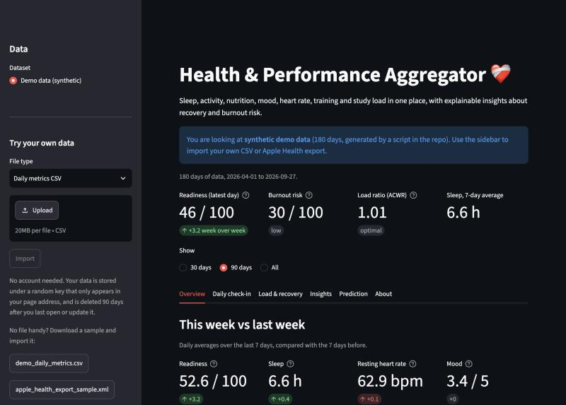
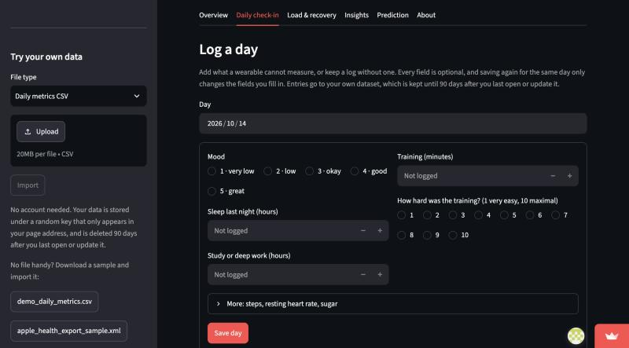
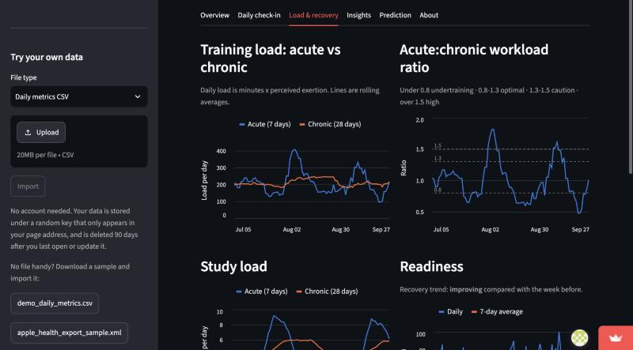
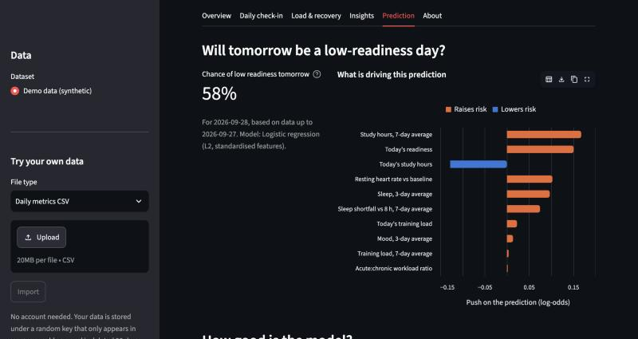
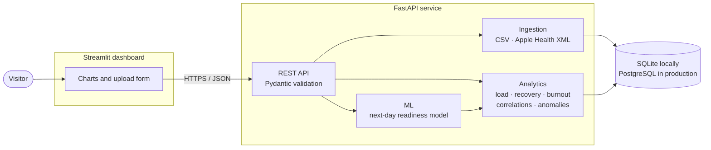

# Health & Performance Aggregator ❤️‍🩹

[](https://github.com/Malak371/health-aggregator/actions/workflows/ci.yml)


**One place for your sleep, activity, nutrition, mood, heart-rate, training and study data, with explainable insights about recovery and burnout risk.**

**Live demo:** <https://health-performance-aggregator.streamlit.app/> (no sign-up; the first load can take about a minute, see [below](#about-the-hosted-demo)) · **API docs:** <https://health-aggregator-api.onrender.com/docs> · **Demo video (original prototype):** [YouTube](https://youtu.be/dTq7Soxa-Gs)

> This is a portfolio project, not a medical device. Nothing it shows is medical advice.



| Daily check-in | Load and recovery |
| --- | --- |
|  |  |



## What it does

- **Unified dashboard** for sleep, steps, resting heart rate, mood, sugar intake, training and study time, opening on a "this week vs last week" summary. The layout adapts to phones.
- **Import your own data** with no sign-up: a daily-metrics CSV or an Apple Health export (the `export.zip` straight from the Health app, or its `export.xml`). The page address becomes a private link to your data. A synthetic sample of each is bundled, so the demo works without personal data.
- **Daily check-in**: log mood, sleep, training effort and study hours in the app, on their own or on top of an import. Data is kept for 90 days after you last use it.
- **Rolling load**: session-RPE training load, 7-day acute and 28-day chronic averages, and the acute:chronic workload ratio (ACWR), plus the same for study hours.
- **Recovery**: a 0-100 readiness score from sleep, resting heart rate against your own baseline, and mood, with a week-over-week trend.
- **Burnout-risk score**: a transparent weighted score that shows how many points each strain signal contributes.
- **Correlations** between signals (including next-day effects) with sample size and strength, worded as associations, not causes.
- **Anomaly detection** against personal baselines: short nights, resting heart-rate spikes, training-load spikes.
- **Next-day prediction**: a logistic-regression model estimates the chance that tomorrow is a low-readiness day, and shows which features push the prediction up or down.
- **Recommendations** that always state the observation that triggered them.

## Architecture



The dashboard contains no analysis code: it only calls the API and draws the results. See [DOCUMENTATION.md](DOCUMENTATION.md) for the system design, data model, formulas and the ML method.

## Tech stack

| Layer | Tools |
| --- | --- |
| API | FastAPI, Pydantic v2, Uvicorn |
| Storage | SQLAlchemy 2, Alembic, SQLite (local) / PostgreSQL (production) |
| Analytics and ML | pandas, NumPy, SciPy, scikit-learn |
| Dashboard | Streamlit, Altair |
| Quality | pytest, ruff, mypy, GitHub Actions |
| Packaging | Docker, docker compose |

## Run it locally

### With Docker

```bash
docker compose up --build
```

Then open the dashboard at <http://localhost:8501> and the interactive API docs at <http://localhost:8000/docs>. This starts PostgreSQL, the API (migrations run on start) and the dashboard.

### Without Docker

Requires Python 3.12.

```bash
python -m venv .venv
source .venv/bin/activate
pip install -r requirements-dev.txt
```

Start the API (SQLite by default):

```bash
cd backend && alembic upgrade head && uvicorn app.main:app --reload
```

In a second terminal, start the dashboard:

```bash
source .venv/bin/activate && streamlit run frontend/app.py
```

Configuration is read from environment variables; copy `.env.example` to `.env` to change the defaults. Setting `DATABASE_URL` to a PostgreSQL URL switches the database.

## Tests and code quality

```bash
pytest              # analytics, parsers, API, ML, migrations, dashboard
ruff check .        # lint
ruff format --check .
mypy                # type-check the backend
```

CI runs all of this on every push and pull request, with the test suite executed against both SQLite and PostgreSQL.

## The ML approach in brief

- **Question:** given everything known up to tonight, will tomorrow be a low-readiness day (the bottom third of this person's own days)?
- **Model:** standardised, L2-regularised logistic regression over ten rolling features (recent sleep, heart-rate deviation, mood, training and study load). It is small enough for a few months of daily data and its coefficients can be read directly.
- **Evaluation:** the most recent 25% of days are held out in time order, never shuffled. On the bundled synthetic data the model scores ROC-AUC 0.79 on 40 held-out days.
- **Honest comparison:** a baseline that simply assumes "tomorrow will be like today" scores 0.82 on the same days. In expanding-window cross-validation the two are level (0.80 vs 0.78). So the model does **not** clearly beat persistence here; what it adds is an explanation of which signals matter. The dashboard shows both numbers.
- **On real people:** run per person on the public [PMData](https://datasets.simula.no/pmdata) dataset (16 people, about five months each), the model predicts the app's computed readiness modestly (mean ROC-AUC 0.64, above chance for 13 of 15 people, ahead of persistence for 9 of 12), but predicts people's own self-reported readiness no better than chance (mean 0.53). Per-person test sets are 16 to 33 days, so these are rough. Training one model across all the other participants gives the same picture: 0.63 for computed readiness, and still below the persistence baseline for self-reported readiness (0.57 at best vs 0.61).
- **Limits:** the demo data is synthetic, test sets are small, and the app's readiness label is derived from the same signals as the features. Details in [DOCUMENTATION.md](DOCUMENTATION.md#6-machine-learning).

## Project layout

```
backend/
  app/
    api/          REST routes and error handling
    ingestion/    CSV and Apple Health parsers
    analytics/    load, recovery, burnout, correlations, anomalies, recommendations
    ml/           feature engineering and the readiness model
    services/     dataset storage and response assembly
  alembic/        database migrations
  scripts/        synthetic data generators, model comparison, PMData validation
frontend/         Streamlit dashboard (API client, charts, app)
data/samples/     synthetic demo CSV and Apple Health sample export
tests/
```

## About the hosted demo

The demo runs on free hosting tiers, which sleep when idle:

- The API sleeps after 15 minutes without traffic and takes about a minute to wake. The dashboard waits for it and shows a "waking up" message.
- The dashboard itself sleeps after 12 hours without visitors; if you see a "this app has gone to sleep" page, click the wake-up button.

## Roadmap

- User accounts, to replace private links
- More importers (Fitbit and Google Fit exports, Garmin)
- Richer inputs for the readiness model (heart-rate variability, sleep stages), since neither per-person nor pooled models could predict self-reported readiness from the current signals
- User-configurable thresholds for alerts and the burnout score

## Acknowledgements

The real-data evaluation uses PMData: V. Thambawita et al., "PMData: A Sports Logging Dataset", ACM MMSys 2020, <https://doi.org/10.1145/3339825.3394926>, licensed [CC BY 4.0](https://creativecommons.org/licenses/by/4.0/). The data was converted to this project's daily format for analysis and is not redistributed here.

## History

This repository merges two earlier projects: the original Streamlit prototype of this app and [performance-tracker](https://github.com/Malak371/performance-tracker), a backend for training and cognitive load. Both commit histories are preserved here.
